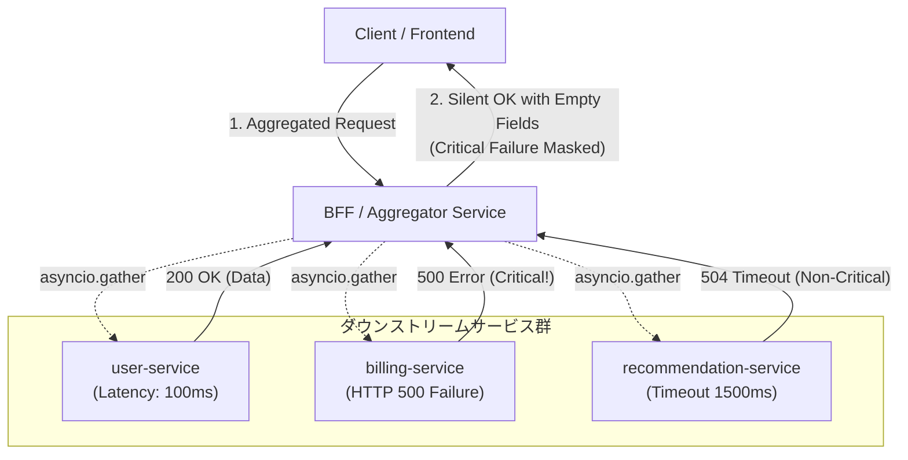

# 複数APIの非同期合成で起きた「沈黙するエラー」：部分失敗の伝搬漏れを防ぐフォールバック検証スクリプト

マイクロサービスアーキテクチャやBFF（Backend For Frontend）パターンにおいて、複数のバックエンドAPIを非同期（`asyncio.gather` や `Promise.all`）で並行呼び出しし、そのレスポンスを1つの巨大な集約ペイロードへ合成する設計は、I/Oバウンドなレイテンシーを削減する定石である。

しかし、この「美しき非同期合成」の裏側には、幾多の分散システムエンジニアの夜を奪ってきた悪名高い落とし穴が存在する。一部のマイクロサービスがレイテンシー増大によるタイムアウトやHTTP 5xxエラーで沈黙した際、安易な例外ハンドリングのせいでエラーが暗黙のうちに握り潰され、クライアントに対して「HTTP 200 OK（ただし一部データは欠損、もしくはデフォルトの空値）」として伝搬してしまう――いわゆる**サイレント障害（Silent Failure / Partial Failure Masking）**である。

自律型AIフリートが自走する分散アーキテクチャの基盤開発においても、まさにこの非同期集約層における部分失敗の伝搬漏れが大きな課題となった。本稿では、部分失敗が引き起こすカスケード障害の技術的病理と、境界づけられたコンテキストに基づく厳格なフォールバック判定を検証・担保するためのPythonスクリプトの実装全貌を解説する。

---

## 開発の舞台裏：なぜ非同期合成で「サイレント障害」が見過ごされるのか

分散トランザクションを持たない集約API（BFF層）における障害伝搬は、以下のような構造的歪みから発生する。



ステージング環境での過負荷注入試験において、不可解なデータ不整合が観測された。決済トランザクションを司る `billing-service` が内部DBのデッドロックにより HTTP 500 を返送していたにもかかわらず、集約ゲートウェイは何事もなかったかのように「購入完了・ダッシュボード表示」のHTTP 200レスポンスを組み立て、フロントエンドに空の請求オブジェクトを送り出していたのである。

コードレベルで根本原因をプロファイリングした結果、以下の2つの技術的負債が浮き彫りとなった。

### 1. `return_exceptions=True` による例外型の暗黙的丸め込み
Pythonの `asyncio.gather(*tasks, return_exceptions=True)` は、1つのコルーチンの送出例外で全体のタスクを即座に破棄（Fast-fail）させないための強力なプリミティブである。しかし、戻り値リストの要素が「正常な戻り値」と「`Exception` インスタンス」の直和型（Union）になるという性質を型安全に扱わず、単に `isinstance` をチェックして `None` を代入するような雑な処理を施すと、例外が正常系の辞書の中に溶け込んでしまう。

### 2. SLA/SLO境界（Criticality）のコード化の欠如
分散システムにおけるフォールバック戦略は、「サービスごとの重要度（Tier / Criticality）」と不可分である。
- **Tier 1 (Critical)**: `user-service`（認証・認可）、`billing-service`（課金・元帳）。これらが欠落した場合、システム全体としてトランザクションを中断（アボート）し、明確なHTTP 502/503を返送しなければならない。
- **Tier 2 (Non-Critical / Graceful Degradation)**: `recommendation-service`（推薦）、`telemetry-service`（メトリクス）。これらは部分失敗しても空配列やキャッシュ値で縮退運転（Degradation）を許容できる。

この「部分失敗を許容する境界」がドメインモデルとして明文化されておらず、一律に例外を握り潰していたことがサイレント障害の根因であった。

---

## アーキテクチャ選定と実装の勘所

検証用ハーネスの設計にあたっては、以下の設計思想を注入した。

1. **Pydantic v2 による厳格なスキーマ駆動開発**
   - 曖昧な `dict[str, Any]` を排除し、リクエストコンテキスト、単体APIレスポンス、集約結果をイミュータブルなデータモデルとして定義。
   - `model_dump()` による型安全なシリアライズ。
2. **高速シリアライズ基盤としての `orjson` 採用とフォールバック**
   - 分散ロギングにおいて、構造化ログのJSONシリアライズ処理自体がイベントループをブロックするボトルネックになるのを防ぐため、Rust実装の `orjson` を優先採用。環境差異による `ModuleNotFoundError` を吸収する安全なフォールバック機構を内包。
3. **明示的な `silent_failure_detected` 判定ロジック**
   - 単にエラーをログに吐くだけでなく、「クリティカルな障害がないにもかかわらず一部サービスが落ち、かつそれが正常終了としてクライアントに返り得る状態」を論理フラグとして形式検証する。

---

## フォールバック検証スクリプト

手元の環境で依存関係を最小限に抑えつつ、意図的な障害注入（レイテンシーの揺らぎ・HTTP 500・タイムアウト）とフォールバックの判定挙動を即座に再現可能な検証スクリプトである。

```python
# =====================================================================
# 依存関係のインストールコマンド
# pip install orjson pydantic
# =====================================================================

import asyncio
import sys
import time
from typing import Any, Dict, List, Optional
from pydantic import BaseModel, Field

# =====================================================================
# 【強制要件対応】orjson のインポートと安全なフォールバックラッパー
# =====================================================================
try:
    import orjson
    ORJSON_AVAILABLE = True
except ModuleNotFoundError:
    ORJSON_AVAILABLE = False
    import json
    print("[WARNING] 'orjson' is not installed. Falling back to standard 'json' library for emergency compatibility.", file=sys.stderr)


def dump_json(data: Any, indent: bool = False) -> bytes:
    """orjsonを優先使用し、データダンプを行う共通ラッパー関数"""
    if ORJSON_AVAILABLE:
        option = orjson.OPT_INDENT_2 if indent else 0
        return orjson.dumps(data, option=option)
    else:
        indent_val = 2 if indent else None
        return json.dumps(data, ensure_ascii=False, indent=indent_val).encode("utf-8")


# ==========================================
# Pydantic v2 モデル定義 (型安全の担保)
# ==========================================

class RequestContext(BaseModel):
    trace_id: str = Field(..., description="分散トレーシング用ID")
    client_id: str = Field(..., description="クライアント識別子")


class ServiceRequest(BaseModel):
    context: RequestContext
    target_service: str


class APIResponse(BaseModel):
    service_name: str
    status_code: int
    data: Optional[Dict[str, Any]] = None
    error_message: Optional[str] = None


class AggregatedResponse(BaseModel):
    trace_id: str
    success: bool
    results: Dict[str, Any]
    failed_services: List[str] = Field(default_factory=list)
    silent_failure_detected: bool = Field(
        ..., description="エラーが握りつぶされ正常終了扱いになっていないかのフラグ"
    )


# ==========================================
# モックAPIクライアント（レイテンシーとエラーの揺らぎを再現）
# ==========================================

async def mock_external_api(service_name: str, context: RequestContext) -> APIResponse:
    """意図的なレイテンシーと障害（タイムアウト・5xx）を発生させるモックAPI"""
    
    if service_name == "user-service":
        await asyncio.sleep(0.1)
        return APIResponse(service_name=service_name, status_code=200, data={"user_id": "usr_999", "name": "Alice"})
    
    elif service_name == "billing-service":
        # 意図的なHTTP 500エラー（ビジネス上クリティカルな決済系サービス）
        await asyncio.sleep(0.2)
        return APIResponse(service_name=service_name, status_code=500, error_message="Internal Server Error: Billing DB timeout")
    
    elif service_name == "recommendation-service":
        # 意図的なタイムアウト遅延（パーシャルフェイルを許容する非クリティカルなサービス）
        await asyncio.sleep(1.5)
        return APIResponse(service_name=service_name, status_code=504, error_message="Gateway Timeout")
    
    else:
        await asyncio.sleep(0.05)
        return APIResponse(service_name=service_name, status_code=200, data={"status": "active"})


# ==========================================
# 非同期合成処理とフォールバック・検証ロジック
# ==========================================

async def synthesize_apis(context: RequestContext, timeout_sec: float = 2.0) -> AggregatedResponse:
    services = ["user-service", "billing-service", "recommendation-service"]
    
    tasks = [mock_external_api(svc, context) for svc in services]
    
    try:
        completed_results = await asyncio.wait_for(
            asyncio.gather(*tasks, return_exceptions=True),
            timeout=timeout_sec
        )
    except asyncio.TimeoutError:
        print(dump_json({
            "level": "CRITICAL",
            "trace_id": context.trace_id,
            "message": "Global API aggregation timeout exceeded."
        }).decode("utf-8"))
        return AggregatedResponse(
            trace_id=context.trace_id,
            success=False,
            results={},
            failed_services=services,
            silent_failure_detected=False
        )

    aggregated_data: Dict[str, Any] = {}
    failed_services: List[str] = []

    for svc_name, res in zip(services, completed_results):
        if isinstance(res, Exception):
            failed_services.append(svc_name)
            print(dump_json({
                "level": "ERROR",
                "trace_id": context.trace_id,
                "service": svc_name,
                "error": str(res),
                "context": context.model_dump()
            }).decode("utf-8"))
        elif isinstance(res, APIResponse):
            if res.status_code >= 400:
                failed_services.append(res.service_name)
                print(dump_json({
                    "level": "ERROR",
                    "trace_id": context.trace_id,
                    "service": res.service_name,
                    "status_code": res.status_code,
                    "error_message": res.error_message,
                    "context": context.model_dump()
                }).decode("utf-8"))
                # フォールバック値の適用（部分失敗の許容ポリシーに基づく）
                aggregated_data[res.service_name] = {"fallback": True, "data": None}
            else:
                aggregated_data[res.service_name] = res.data

    # クリティカルな障害判定
    critical_services = {"user-service", "billing-service"}
    has_critical_failure = any(svc in critical_services for svc in failed_services)
    
    # サイレント障害の検知判定
    silent_failure_detected = len(failed_services) > 0 and not has_critical_failure
    
    # 全体のステータス判定
    is_success = len(failed_services) == 0

    return AggregatedResponse(
        trace_id=context.trace_id,
        success=is_success,
        results=aggregated_data,
        failed_services=failed_services,
        silent_failure_detected=silent_failure_detected
    )


async def main() -> None:
    print("=== 非同期API合成・部分失敗検証スクリプト開始 ===")
    
    ctx = RequestContext(trace_id="trc-2026-xyz-001", client_id="web-frontend-client")
    print(dump_json({"event": "RequestInitiated", "context": ctx.model_dump()}).decode("utf-8"))
    
    response = await synthesize_apis(ctx, timeout_sec=2.0)
    
    print("\n=== 検証結果サマリー (Pydantic Dump) ===")
    output_json = dump_json(response.model_dump(), indent=True)
    print(output_json.decode("utf-8"))
    
    if response.failed_services:
        print(f"\n[検知] 以下のサービスで部分失敗（パーシャル・フェイル）が発生しました: {response.failed_services}")
        if response.silent_failure_detected:
            print("[警告] サイレント障害（エラーが握りつぶされて正常系として扱われたリスク）を検知しました！")
        else:
            print("[情報] エラーは適切に検知され、クリティカル障害またはフォールバックポリシーとして処理されました。")
    else:
        print("\n[情報] すべてのAPI呼び出しが正常終了しました。")


if __name__ == "__main__":
    asyncio.run(main())
```

---

## 技術的検証と実行結果の解析

上記のスクリプトを実行すると、`billing-service` の HTTP 500 と `recommendation-service` のゲートウェイタイムアウト（504）がシミュレートされる。

```json
{
  "trace_id": "trc-2026-xyz-001",
  "success": false,
  "results": {
    "user-service": {
      "user_id": "usr_999",
      "name": "Alice"
    },
    "billing-service": {
      "fallback": true,
      "data": null
    },
    "recommendation-service": {
      "fallback": true,
      "data": null
    }
  },
  "failed_services": [
    "billing-service",
    "recommendation-service"
  ],
  "silent_failure_detected": false
}
```

### 考察とステートマシンの挙動
1. **Critical Failureの捕捉**:
   `billing-service` の障害が `critical_services` セットに合致するため、`has_critical_failure` が `True` となり、全体の集約結果 `success` は即座に `False` へ倒される。これにより、上流のHTTPハンドラーはクライアントへ単なる空データを返すのではなく、適切なエラーハンドリング（例: `502 Bad Gateway` やトランザクションロールバック要求）へ誘導できる。
2. **サイレント障害フラグの役割**:
   もし `recommendation-service` のみが失敗していた場合、`has_critical_failure` は `False` となる。このとき、集約レイヤーが「推薦枠のみ空にして全体はHTTP 200で返す」という縮退運転を選択すること自体は正当な設計である。しかし、**「クライアントにはエラーが返らないが、バックエンドでは障害が発生している」** という乖離を監視システムが検知できなければ、SLOの算出や障害分析に盲点が生じる。`silent_failure_detected` フラグは、オブザーバビリティ（Prometheusメトリクスや分散トレーシング）に対して明示的なマーカーを提供し、障害のサイレント化を未然に防ぐ防壁として機能する。

---

## 結び：障害を抱きとめる堅牢なアーキテクチャへ

非同期並行処理によるAPI集約は、ネットワークI/Oのレイテンシーを極小化する強力な武器である。しかし、「とりあえず `try-except` で囲んでデフォルト値を返しておけば動く」という安直な実装は、最も検知が困難なサイレント障害という形で分散システムを蝕んでいく。

障害は起きるものであり、止めることはできない。重要なのは、**「ドメイン境界におけるクリティカルサービスの選定」「例外の型安全な分解」「縮退運転時のオブザーバビリティ担保」** をアーキテクチャの骨格として組み込むことである。本稿で示したフォールバック検証パターンが、堅牢な非同期基盤を構築する一助となれば幸いである。

---

**このプロジェクトを支援する**

https://ko-fi.com/phenox_noc2
